
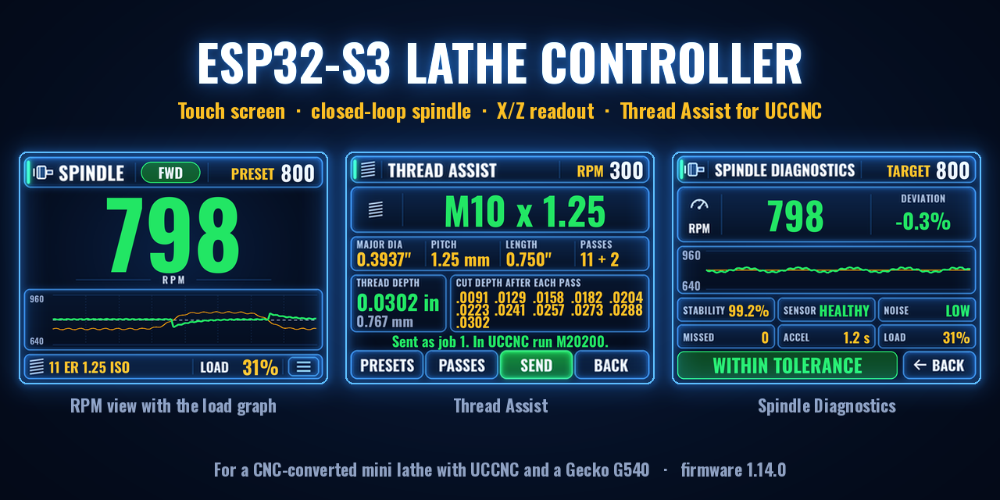

# ESP32-S3 Lathe Controller

A touch screen and a Wi-Fi dashboard for a CNC-converted mini lathe. An ESP32-S3 reads encoders on the spindle and on both slides, holds the spindle speed in a closed loop through the lathe's own speed-pot input, and shows it all on a 2.8 in touch display at the machine and in any browser.

It was built for a Vevor MX-210V (8 × 16) mini lathe converted to CNC with UCCNC, a UC100 and a Gecko G540, and works next to the motion controller: it never drives the steppers.

**Firmware 1.15.0 · web page 1.27.0** · [Download](https://github.com/winreboot/esp32s3-lathe/releases) · [Build guide](docs/BUILD_GUIDE.md) · [What changed](CHANGELOG.md)

## On the screen

Every screen has glowing panels, shaded buttons and icons, drawn once on a PC (`tools/make_art.py`) and stored in the firmware; the live numbers, values and graphs are painted on top. The pictures below are made from the same artwork with sample values.

<table>
<tr>
<td width="50%">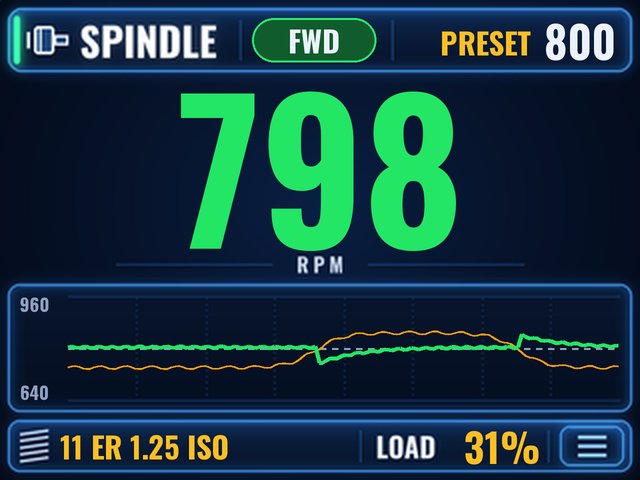 <b>RPM view.</b> The speed in large digits, direction, the preset, and a 37-second graph: green is the measured speed, amber the drive. Under load you see the dip and the recovery.</td>
<td width="50%">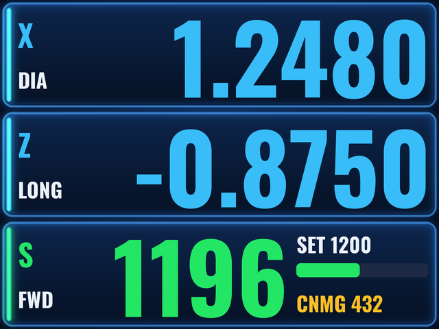 <b>Everything.</b> X (diameter or radius), Z and the spindle, with the set speed, a speed bar and the loaded tool.</td>
</tr>
<tr>
<td>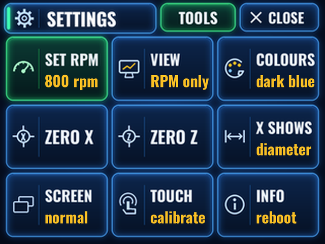 <b>Settings.</b> A tap anywhere opens it. Nine buttons show their current value; <b>TOOLS</b> opens the three tool screens.</td>
<td>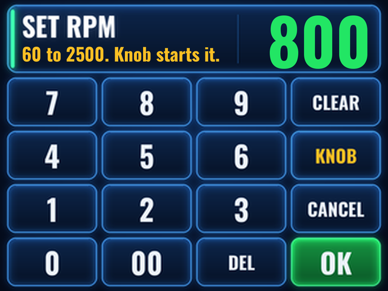 <b>Set RPM.</b> Type a speed. The knob stays the start and stop: turned up, the spindle runs at the typed speed wherever the knob sits.</td>
</tr>
<tr>
<td>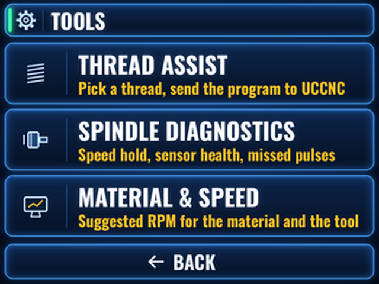 <b>Tools.</b> Thread Assist, Spindle Diagnostics and Material &amp; Speed.</td>
<td>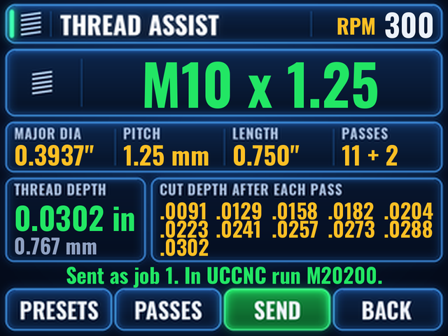 <b>Thread Assist.</b> Pick a thread, type the length, choose the passes. It shows the thread depth and the depth after every pass, and <b>SEND</b> makes the G33 program for UCCNC.</td>
</tr>
<tr>
<td>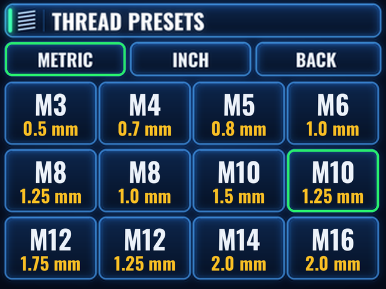 <b>Thread presets.</b> Twelve metric and twelve inch threads.</td>
<td>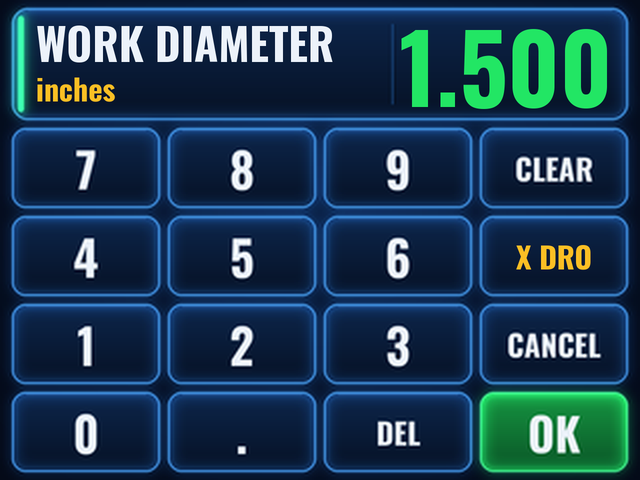 <b>Number pad.</b> For the thread length and the work diameter, or take the value from the Z or X readout.</td>
</tr>
<tr>
<td>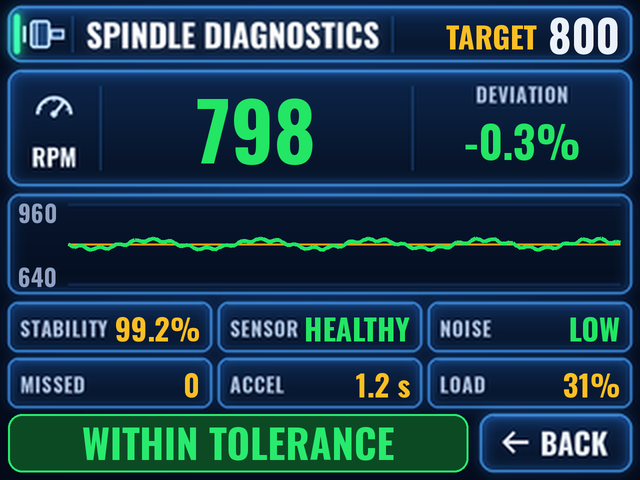 <b>Spindle Diagnostics.</b> Deviation from the target, stability, sensor health, encoder noise, missed pulses, time to reach speed, load, and one verdict.</td>
<td>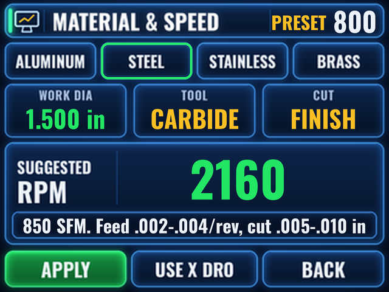 <b>Material &amp; Speed.</b> Material, HSS or carbide, roughing or finishing, and the diameter give a suggested RPM, kept inside your lathe's limits. <b>APPLY</b> sets it.</td>
</tr>
<tr>
<td>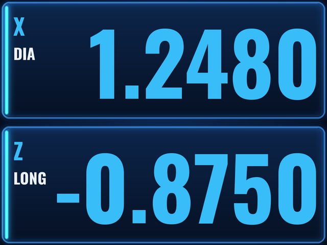 <b>X and Z.</b> Two tall rows when the spindle speed is not needed.</td>
<td>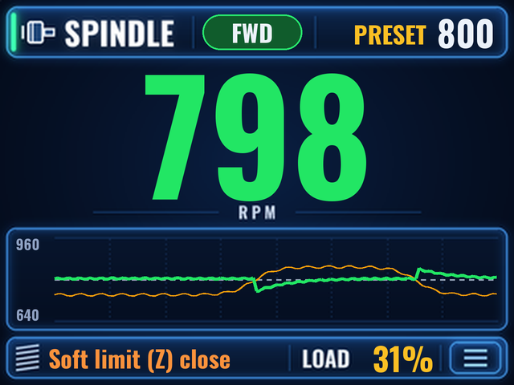 <b>Alarms.</b> A soft limit close, or the encoder signal lost while the spindle should turn, replaces the tool line.</td>
</tr>
<tr>
<td>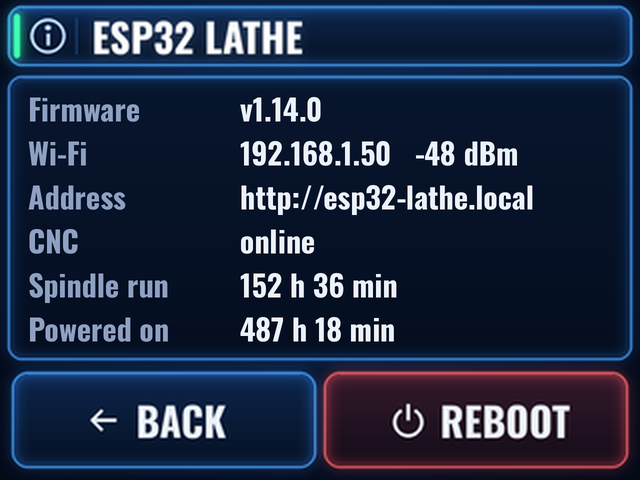 <b>Info.</b> Firmware, Wi-Fi address and signal, CNC online, spindle run hours and powered-on hours, and Reboot.</td>
<td>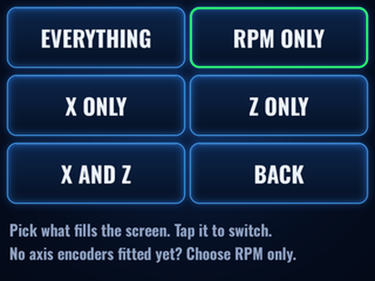 <b>View.</b> Choose what fills the screen: everything, RPM only, X only, Z only, or X and Z.</td>
</tr>
</table>

### Dark blue or black

**Colours** on the Settings menu switches every screen to a black background with the same glow.

<table>
<tr>
<td width="50%">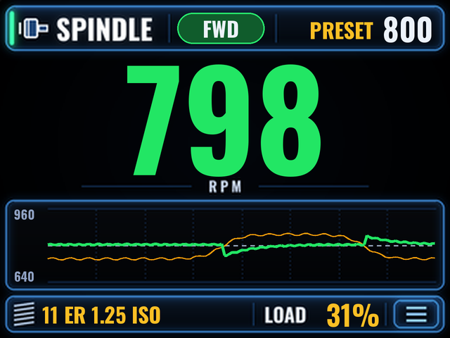</td>
<td width="50%">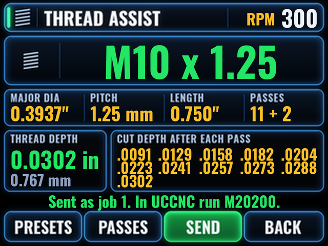</td>
</tr>
<tr>
<td>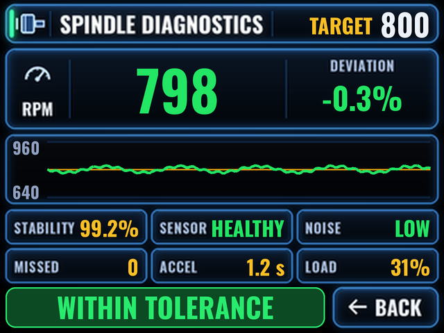</td>
<td>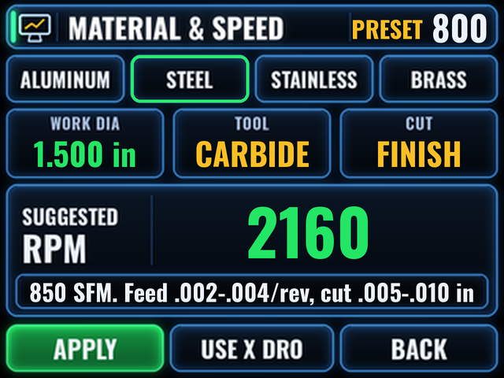</td>
</tr>
</table>

All screens in both colours are in [docs/screens](docs/screens).

## What it does

| Feature | What it gives you |
| --- | --- |
| **Closed-loop spindle speed** | The 100 P/R spindle encoder measures the speed and a PI loop drives the lathe's own speed-pot terminals through an optocoupler, so the speed holds when a cut loads the spindle. The lathe side stays isolated. |
| **Speed from the screen** | Type an RPM on the touch screen; the knob starts and stops the spindle. The web page can set a target too. |
| **X and Z readout** | A 600 P/R encoder on each slide, counted in hardware at 2400 counts per revolution. X as diameter or radius, inch units. |
| **Thread Assist** | Choose a thread at the lathe, see the pass plan, and send the program to UCCNC without walking to the PC. |
| **Spindle Diagnostics** | Shows whether the spindle holds speed and whether the encoder is healthy, so a bad thread can be blamed on the right thing. |
| **Material & Speed** | A suggested spindle speed for the material, the tool and the diameter, for a good finish. |
| **G-code generators** | Parting off with a zig-zag or pecks, grooving, facing, turning, tapers, waves and peck drilling: pick the tool, enter the sizes, press Play to watch it cut, and send the program to UCCNC. |
| **Web dashboard** | Any browser on your network: live readout and spindle gauge, a Thread Wizard for 13 thread forms (UN, ISO, Acme, Trapezoidal, Whitworth, BSP, NPT and more) with insert suggestions, a tool list, recording with G-code export, run hours, alarms, settings and firmware updates over Wi-Fi. |
| **Works with UCCNC** | The spindle encoder is shared with the G540, so G33 threading keeps working. The ESP32 only watches the axes. |

It is not a safety device: keep the lathe's emergency stop within reach.

### Thread Assist: from the screen to UCCNC

The ESP32 cannot write a file onto the PC, so the PC fetches the program (the same way for programs sent from the dashboard):

1. On the lathe: Settings → **TOOLS** → **Thread Assist**. Press **PRESETS** and pick the thread, tap **LENGTH** to type the length in inches, and **PASSES** to choose 6, 8, 11 or 14 passes (two spring passes are always added). Press **SEND**.
2. On the PC, either
   - **in UCCNC:** type `M20200` in the MDI line. The macro downloads the program from the ESP32 and loads it. Install it once: on the dashboard, **Help → Wiring diagram** (the display notes) has a download link for `M20200.txt`, written with your ESP32's address; save it in `C:\UCCNC\Profiles\Macro_<your profile>\`. Or
   - **in the browser:** the dashboard's Thread Wizard shows the program with a download link.
3. Check the loaded program in UCCNC's toolpath view before the first cut. The program stays on the ESP32 until it restarts.

The program is the same one the web page's Thread Wizard writes with its default choices: flank infeed at 29.5°, equal metal per pass, a stop to try the nut, and the tool always moved out in X before it travels along Z.

### G-code generators on the dashboard

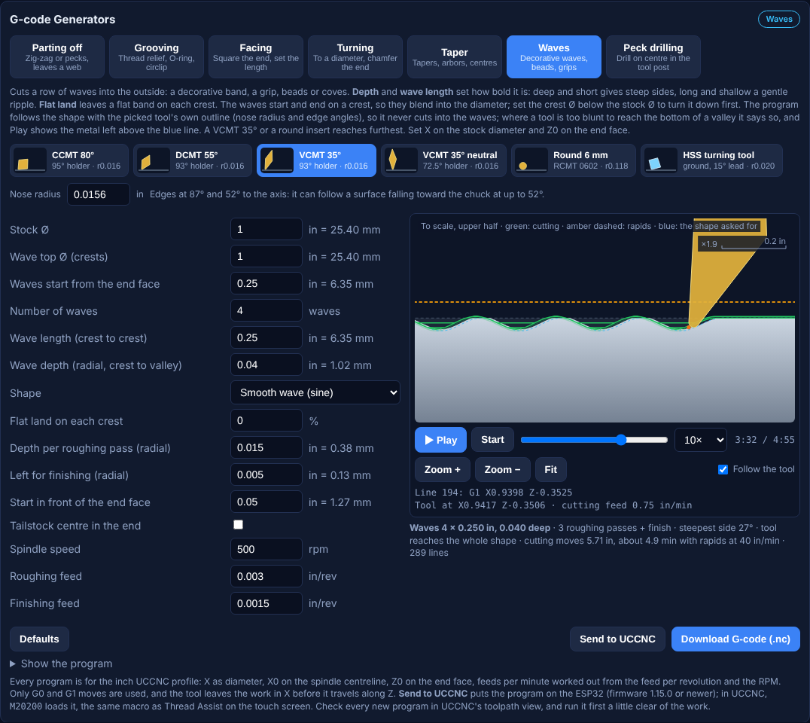

The dashboard's **G-code** page writes the everyday programs from a few sizes, with a to-scale preview, a **Play** button that runs the program on the drawing, and warnings before anything is cut:

| Generator | What it does |
| --- | --- |
| **Parting off** | A **zig-zag** ramp across a groove a little wider than the blade, going deeper on every crossing so the blade never takes a full-width plunge, or **step plunges** with a back-off before each one. The extra width goes toward the chuck so the part keeps its length. It stops at a web diameter you choose (or cuts through), slows the feed near the centre and can leave the groove to clear chips. |
| **Grooving** | Grooves wider than the tool, with a finishing pass on both walls and the floor: thread relief, O-ring and circlip grooves. |
| **Facing** | Passes from the outside to the centre or to a bore, a light finishing pass, and just past the centre so no pip is left. |
| **Turning** | Roughing to a diameter over a length, a finishing pass that squares the shoulder, and an optional 45° chamfer at the end. |
| **Taper** | Arbors and centres: roughing that follows the taper, then a finishing pass; shows the included angle and the taper per foot. |
| **Waves** | A row of waves cut into the outside, for a decorative band or a grip: smooth (sine), round beads, round coves or straight-sided V, with the depth, the wave length and a flat land on each crest to make it bolder or flatter. The path follows the picked tool's real outline, so it never cuts into the waves, and it says how much a tool too blunt for the valleys would leave. |
| **Peck drilling** | For a drill held on centre in the tool post, with pecks out of the hole or short back-offs. |

Every program is plain G0/G1 G-code for the inch UCCNC profile (X as diameter, Z0 on the end face), and the tool always leaves the work in X before it travels along Z. **Send to UCCNC** puts the program on the ESP32 and `M20200` loads it, as for Thread Assist; **Download** saves the `.nc` file. The Thread Wizard has the same Send button. Each generator was checked with a cutting simulation: no rapid passes through metal, no cut is deeper than asked, and the finished shapes match the sizes entered.

**Pick the tool.** A row of buttons above the form offers the tools that suit the program: HSS parting blades (1/16, 3/32, 1/8 in) and 2 or 3 mm grooving inserts; CCMT 80°, DCMT 55° and VCMT 35° inserts in their usual holders, a VCMT in a neutral holder, a 6 mm round insert and a ground HSS turning tool, each with a nose radius you can change; twist and split-point drills. Tools saved on the Tools page whose name holds an insert code (CCMT 09T304, DCMT 21.51, MGMN 300 and so on) appear there too. The tool is drawn in the preview, named in the program header, and used for the waves' path and for Play. Programs drive the tool tip as touched off (X on a diameter, Z on the end face), with no nose radius compensation; the page says what a nose radius does to a shoulder, a chamfer or a taper, and by how much.

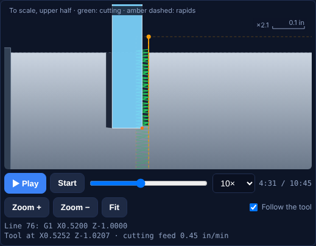

**Play.** The preview opens on the finished result. Play runs the program from the start and takes the metal off as the tool moves, at 1× (real time) up to 100×, with the line being run and the tool position under the drawing. Drag the slider to any point, or click a line in the program to see the state after it. Zoom with + and − or the mouse wheel, drag to look around, and Follow keeps the tool in view. A rapid move that would cut metal with the picked tool is marked in red and listed in the warnings.

### Spindle Diagnostics: what the readings mean

| Reading | Meaning |
| --- | --- |
| Deviation | How far the speed is from the target, in percent |
| Stability | 100 % minus the spread of the speed over the last 10 s |
| Sensor, Noise, Missed | Between two index pulses (encoder Z, GPIO 6) there must be exactly one turn's worth of A pulses. Fewer are missed pulses, more are noise. Without the index wired these show A/B ONLY |
| Accel | How long the spindle took to come within 3 % of the last new speed |
| Load | The drive the controller is giving |
| Verdict | WITHIN TOLERANCE: within 2 % of the target, at least 98 % stable, no encoder faults. A tap restarts the counts |

### Material & Speed: the numbers

Suggested RPM = surface speed × 3.82 ÷ diameter in inches, kept inside your Min and Max RPM. Surface speeds in feet per minute:

| Material | HSS rough | HSS finish | Carbide rough | Carbide finish |
| --- | --- | --- | --- | --- |
| Aluminum | 500 | 600 | 2000 | 2820 |
| Steel (1018 type) | 125 | 215 | 600 | 850 |
| Stainless (300 series) | 115 | 135 | 400 | 570 |
| Brass | 300 | 350 | 820 | 1170 |

HSS figures and the carbide finishing column are from LittleMachineShop's [turning speeds table](https://littlemachineshop.com/reference/cuttingspeeds.php); carbide roughing is about 70 % of the finishing figure. They are starting points: slow down if it chatters.

## Get the firmware

### Arduino IDE (easiest)

1. From [Releases](https://github.com/winreboot/esp32s3-lathe/releases), download `esp32s3_lathe_fw1.15.0_page1.27.0_arduino.zip`. It holds the sketch and the four libraries it needs.
2. Boards Manager: install **esp32** by Espressif Systems (3.x, checked with 3.3.13, or 2.0.17).
3. Copy the folders in `libraries` into your Arduino libraries folder and restart the IDE.
4. Open `esp32s3_lathe/esp32s3_lathe.ino`. The **Tools** menu settings are at the top of that file: ESP32S3 Dev Module, USB CDC On Boot Enabled, Flash 8 MB, partition "8M with spiffs", PSRAM OPI.
5. Upload. The web page is built into this firmware, so nothing else needs uploading.

The same sketch is in [`arduino/esp32s3_lathe`](arduino/esp32s3_lathe); it is generated from `src/main.cpp` by `tools/make_arduino.py`.

### PlatformIO

`pio run -t upload` for the firmware, then `pio run -t uploadfs` for the web page in `data/` (this erases saved recordings).

### First start

With no Wi-Fi saved, the ESP32 opens the access point **ESP32-Lathe** (password `lathe1234`). Join it, open http://192.168.4.1, enter your Wi-Fi in **Settings** and choose **Save & reboot**. After that the dashboard is at http://esp32-lathe.local or at the address on the display's Info screen. Later firmware can be uploaded from the dashboard's **Firmware** window.

## Hardware

### Today: ready-made modules

The controller is built from an **ESP32-S3-DevKitC-1** (8 MB flash and octal PSRAM, such as N8R8 or N16R8), a **2.8 in ILI9341 SPI touch display** (XPT2046), three **BSS138 level shifter modules**, a **PC817 optocoupler module** and **Omron E6B2-CWZ6C** encoders: 100 P/R on the spindle, 600 P/R on each slide. The [build guide](docs/BUILD_GUIDE.md) has the parts list, every connection and the calibration; the dashboard's **Help** has the same guide with an interactive wiring diagram.

### Coming soon: the Lathe Carrier board

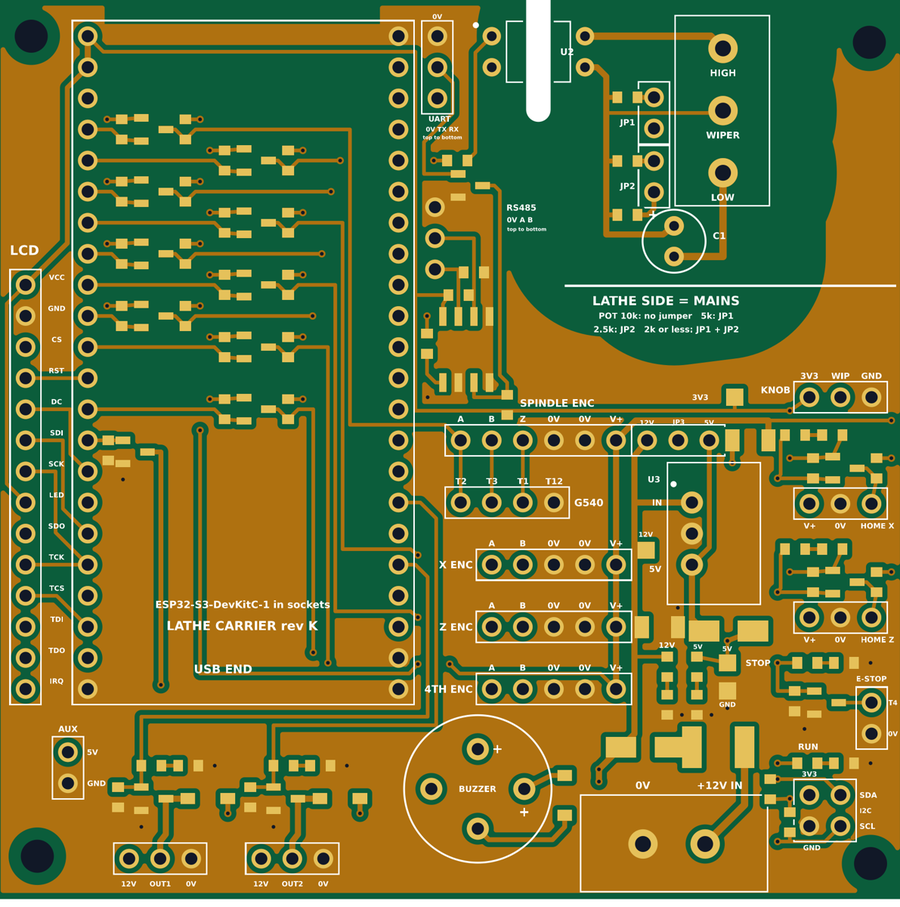

A carrier board for the ESP32-S3-DevKitC-1 that replaces the level shifter modules, the PC817 module and the jumper wires. **It will be available to purchase soon.** The picture is a render of the top side from the manufacturing files; the first boards are being made.

- 74.5 × 73.5 mm, one 12 V supply with resettable fuses and reverse-polarity protection; 5 V is made on the board
- Four encoder inputs: the spindle with its index, plus X, Z and a 4th axis, level-shifted, with 12 V or 5 V sensor supply by jumper
- Isolated speed output in place of the lathe's speed pot, for 10k, 5k, 2.5k or smaller pots by jumper, with 8 mm of creepage to the low-voltage side
- Connection to the G540 for the shared spindle encoder, a speed knob input, and a header for the 2.8 in touch display
- Two home-sensor inputs, a stop output, two switched 12 V outputs, a buzzer, status LEDs, RS-485, I2C and UART

The lathe firmware uses the same pins as the board for the encoders, the knob, the speed output and the display.

### Coming later: more uses for the board

Firmware for the board's other features is being prepared and **will be released later**. Each one has its own screen in the same style:

<table>
<tr>
<td width="50%">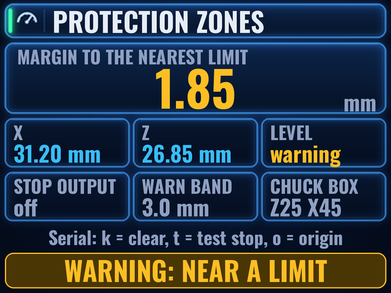 <b>Protection zones.</b> A warning band before each travel limit and round the chuck, then a stop signal to the motion controller.</td>
<td width="50%">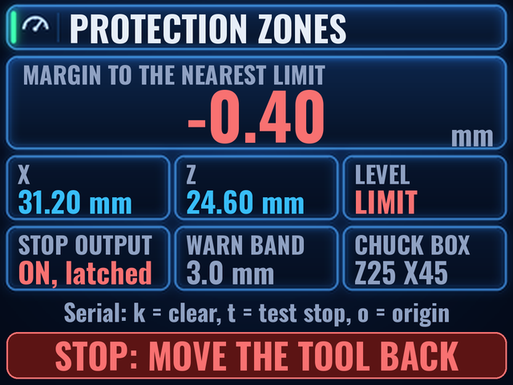 Past a limit: the stop output is on and stays on until the tool is back and you acknowledge it.</td>
</tr>
<tr>
<td>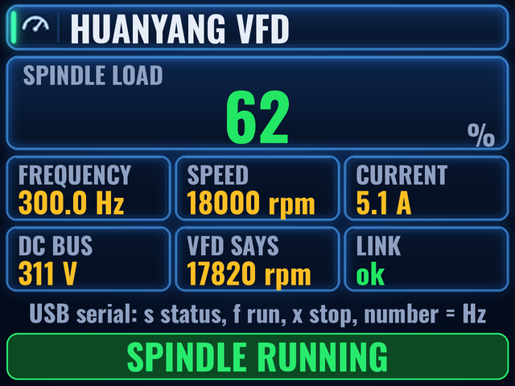 <b>VFD spindle monitor.</b> Load, frequency, speed, current and DC bus voltage from a Huanyang VFD over RS-485.</td>
<td>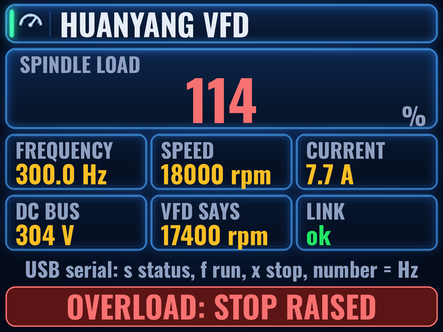 On overload it can pause the feed before the cutter breaks.</td>
</tr>
<tr>
<td>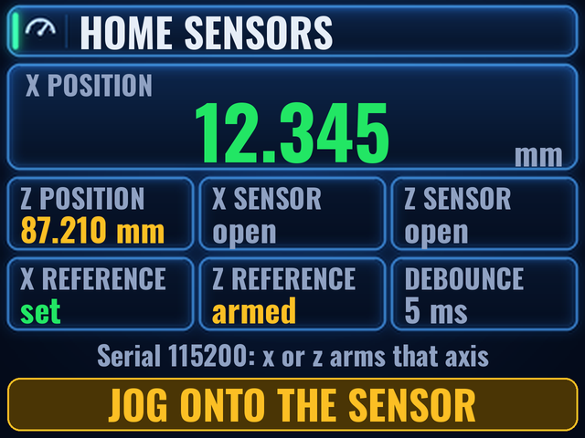 <b>Home sensors.</b> X and Z referenced from proximity sensors.</td>
<td>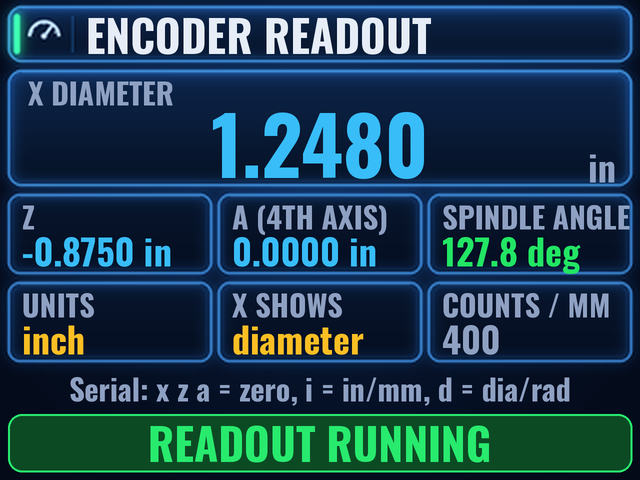 <b>Four-channel readout.</b> X, Z, a 4th axis and the spindle angle, for manual machines too.</td>
</tr>
<tr>
<td>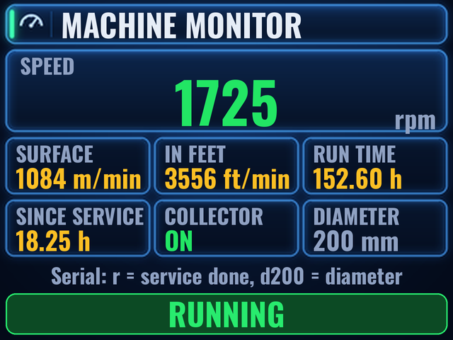 <b>Machine monitor.</b> Speed, surface speed, run hours, a service reminder and the dust collector, for machines with no controller of their own.</td>
<td>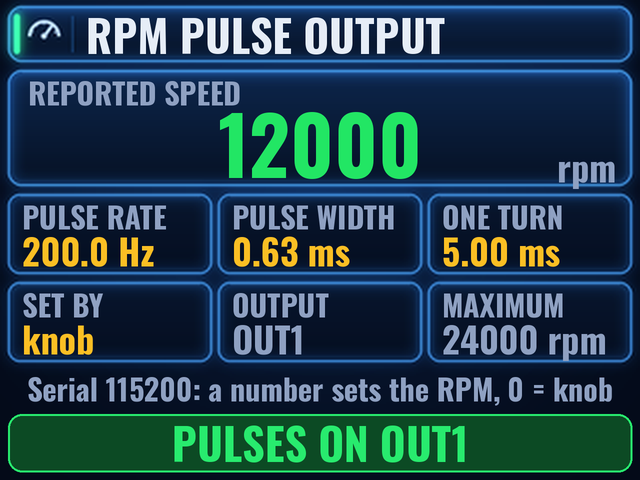 <b>RPM pulse output.</b> One pulse per spindle turn to a G540 input, so UCCNC shows the speed.</td>
</tr>
<tr>
<td>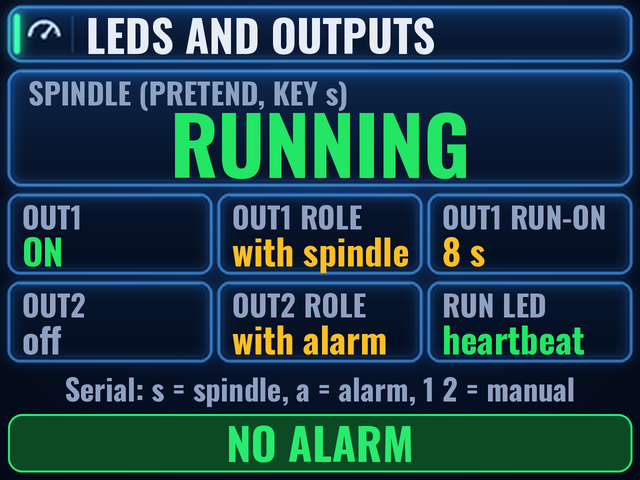 <b>Switched outputs.</b> A dust collector or mister that follows the spindle, with a run-on time.</td>
<td>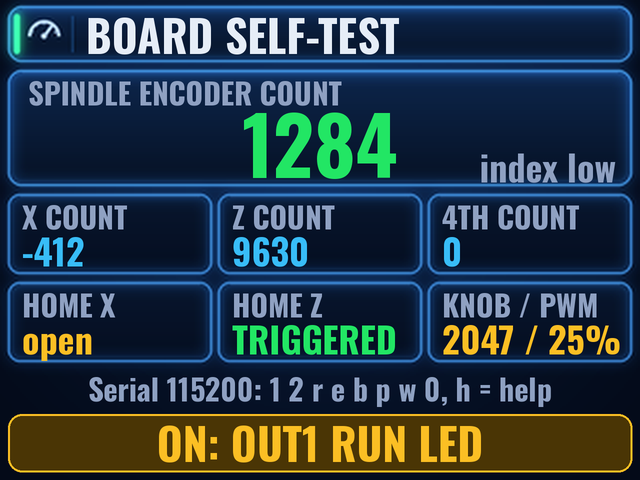 <b>Board self-test.</b> Every input and output on one screen, for checking a new board.</td>
</tr>
</table>

## Safety

- The lathe's speed-pot terminals are at mains potential on most mini lathes. Measure before connecting, keep everything on that side insulated and inside the controller enclosure, and never join it to the ESP32's ground. The build guide explains the checks.
- The controller never drives the steppers and does not replace the lathe's emergency stop.

## Repository

| Folder | Contents |
| --- | --- |
| `src/main.cpp` | The firmware (PlatformIO, Arduino-ESP32 core 2.0.17) |
| `arduino/esp32s3_lathe/` | The same firmware as an Arduino IDE sketch, for core 3.x or 2.0.17 |
| `data/index.html` | The web dashboard |
| `art/`, `fonts/` | Screen artwork and the Oswald fonts, linked into the firmware |
| `tools/` | `make_art.py` (artwork), `make_vlw.py` and `make_vlw_text.py` (fonts), `make_arduino.py` (the sketch) |
| `docs/` | Build guide, screen pictures, the board render |

Libraries: [LovyanGFX](https://github.com/lovyan03/LovyanGFX), [ESPAsyncWebServer and AsyncTCP](https://github.com/ESP32Async), [ArduinoJson](https://arduinojson.org). Fonts: Oswald, under the SIL Open Font License (`fonts/OFL.txt`).
