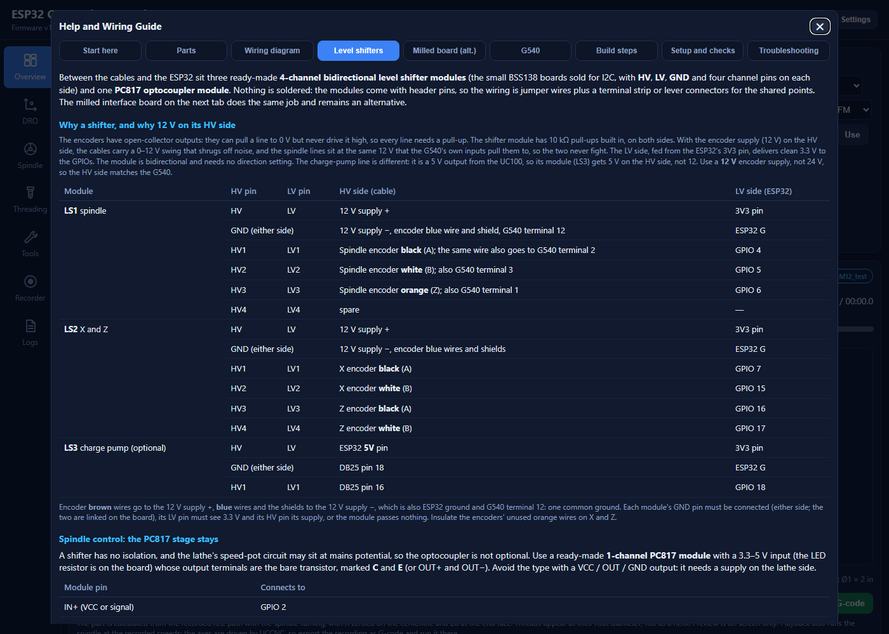

# ESP32-S3 Lathe Control: build guide

A step-by-step guide to building the controller: flashing the ESP32-S3, wiring the touch display, the level shifter modules and the PC817 module, mounting the encoders, connecting the G540 and the lathe, and calibrating. The same guide, with the interactive wiring diagram and tick-off checklist, is on the dashboard under **Help**; this copy lives with the code so it can be read without the ESP32.

Versions this guide matches: firmware **1.7.0**, web page **1.21.x**. The `CHANGELOG.md` lists what changed since.

## What the finished system does

| Function | How |
| --- | --- |
| Live DRO for X and Z | A 600 P/R encoder on each slide, counted in hardware (2400 counts per rev) |
| Spindle RPM and direction, closed-loop speed control | The 100 P/R spindle encoder, and a PC817 optocoupler driving the lathe's own speed-pot input |
| 2.8 in touch display at the machine | RPM, X and Z in large digits, in the layout you choose; a tap opens a Settings menu |
| Web dashboard over Wi-Fi | Settings, recording and playback with G-code export, threading presets, run hours, alarms, OTA updates |
| CNC Online indicator (optional) | A tap on the G540 charge-pump line |

It never drives the steppers and never replaces the lathe's E-stop.

## 1. Parts

### Required

| Qty | Part | Used for | Notes |
| --- | --- | --- | --- |
| 1 | ESP32-S3 dev board, 44-pin | The controller | At least 8 MB flash and octal PSRAM (N8R8 or N16R8) |
| 1 | USB charger, 5 V 1 A or more, and cable | Powers the ESP32 and the display | A noisy charger causes false counts |
| 1 | 2.8 in ILI9341 SPI TFT, 320 × 240, **touch version** (XPT2046) | DRO, RPM and status at the machine | The common red-board module |
| 3 | 4-channel bidirectional level shifter module (BSS138 type, sold as "IIC I2C logic level converter 3.3V-5V", pins pre-soldered) | LS1 spindle lines, LS2 X and Z encoders, LS3 charge pump | LS3 only with the optional CNC Online signal. Sold in packs of ten |
| 1 | PC817 optocoupler module, 1 channel, 3.3–5 V input, **bare C and E output** | Isolates spindle control from the lathe | Not the VCC/OUT/GND output type. Or a PC817 and a 330 Ω resistor on perfboard |
| 2 | Omron E6B2-CWZ6C encoder, **600 P/R** | X and Z position | Must be the CWZ6C (open collector), 6 mm shaft |
| 1 | Omron E6B2-CWZ6C encoder, **100 P/R** | Spindle speed and direction | Skip if already fitted; turns 1:1 with the spindle |
| 1 | **12 V** DC supply, 0.5 A or more | Powers the encoders and the shifters' HV side | 12 V, not 24: the HV side must match the G540's inputs |
| 2 | Flexible shaft coupling, 6 mm to your shaft | Drives each axis encoder | Jaw or bellows type |
| 2 | Encoder mounting bracket | Holds each axis encoder | Made to suit your lathe |
| 1 | 4.7 kΩ resistor, 1/4 W | Speed signal filter at the PC817 output | |
| 1 | 10 µF electrolytic capacitor, 25 V | Speed signal filter at the PC817 output | At least double your pot voltage |
| 1 | 10 kΩ linear potentiometer and knob | Speed knob | Linear (B taper) |
| 1 pack | Dupont jumper wires, female-to-female and female-to-male | Module pins to the ESP32 and the terminal strip | |
| 1 | Screw terminal strip, about 12 ways, or lever connectors | Joins the encoder cables, the 12 V supply, the grounds and the module supply pins | |
| 1 set | Stranded hookup wire, 22–24 AWG | ESP32, module and display wiring | The G540 needs stranded 14–24 AWG |
| 1 | 4-core cable, shielded if possible | Spindle A, B, Z and ground to G540 terminals 2, 3, 1 and 12 | |

Optional and recommended: DB25 male-female breakout for the CNC Online signal; shielded 5-core cable if the encoder leads need extending; a plastic enclosure with a window for the display; 22-way header sockets so the ESP32 can be swapped; encoder guards; heat-shrink, ferrules, cable ties and labels.

Tools: soldering iron (only for the two filter parts, if you don't use a terminal strip), multimeter, wire strippers, small flat screwdriver, and a dial indicator for calibrating the axes.

## 2. Flash the ESP32 and prove it on the bench

1. Install PlatformIO (the VS Code extension, or `pip install platformio`).
2. In the project folder: `pio run -t upload` (firmware), then `pio run -t uploadfs` (the web page in `data/`).
3. Plug the ESP32 into the charger with nothing else attached. The blue LED flashes, then goes solid or flashes very fast.
4. First boot: no Wi-Fi is configured, so it opens the access point **ESP32-Lathe** (password `lathe1234`). Join it, open http://192.168.4.1, enter your Wi-Fi name and password in **Settings**, and **Save & reboot**.
5. Afterwards the dashboard is at http://esp32-lathe.local (or the IP shown on the page and on the display's Info screen). Later firmware goes in through the **Firmware** window on the page.
6. Unplug the ESP32. Do this every time before you change wiring.

## 3. The display

Wire the module straight to the ESP32-S3 DevKitC-1. Keep the wires under about 20 cm.

| Module pin | ESP32 pin | Notes |
| --- | --- | --- |
| VCC | **3V3** or **5V** | Look at the **J1** jumper on the back. Bridged (the DIANN board): 3V3. Open: 5V (the module then regulates it down). Wrong choice: black screen or a faint picture |
| GND | G | |
| CS | GPIO 10 | |
| RESET | GPIO 8 | |
| DC (RS) | GPIO 9 | |
| SDI (MOSI) | GPIO 11 | |
| SCK | GPIO 12 | |
| LED | 3V3 | Backlight. Without it the screen looks dead with only a ghost of the picture |
| T_CLK | GPIO 12 | In parallel with SCK (second wire on the pin, or a short jumper on the module) |
| T_DIN | GPIO 11 | In parallel with SDI |
| T_DO | GPIO 13 | |
| T_CS | GPIO 14 | |
| SDO (MISO), T_IRQ | not connected | |

Power up. You should see the lathe picture with the firmware version for two seconds, then the DRO. The **first tap** on the screen starts the touch calibration: press the three crosses as they appear, firmly, with a fingernail or the stylus. After that, a tap anywhere opens the Settings menu.

In the menu, **View** chooses what fills the screen: Everything, **RPM only**, X only, Z only, or X and Z. Pick RPM only until the axis encoders are fitted, so the screen does not show two axes at zero. If the colours look wrong (the workpiece in the power-up picture should be brass yellow; in the menu the squares marked R, G and B should be red, green and blue), turn on **Swap red / blue**. Everything set in the menu is saved. Unplug again.

## 4. The level shifter modules

Every encoder and G540 line reaches the ESP32 through a 4-channel bidirectional level shifter module. The encoders have open-collector outputs (they pull a line to 0 V but never drive it high), so every line needs a pull-up, and the module has 10 kΩ pull-ups built in on both sides. With the 12 V encoder supply on the **HV** side, the cables carry a 0–12 V swing that shrugs off noise, and the spindle lines sit at the same 12 V the G540's own inputs pull them to. The **LV** side, fed from the ESP32's 3V3 pin, delivers 3.3 V to the GPIOs. The charge-pump line is a 5 V output from the UC100, so its module gets 5 V on HV.

Each module has, on one side, `HV HV1 HV2 GND HV3 HV4` (or similar) and on the other `LV LV1 LV2 GND LV3 LV4`; read the labels on yours.

| Module | Pin | Cable side (HV) | ESP32 side (LV) |
| --- | --- | --- | --- |
| **LS1** spindle | HV / LV | 12 V supply + | 3V3 pin |
| | GND (either side) | 12 V supply −, encoder blue and shield, G540 terminal 12 | ESP32 G |
| | HV1 → LV1 | Spindle encoder **black** (A); the same wire also goes to G540 terminal 2 | GPIO 4 |
| | HV2 → LV2 | Spindle encoder **white** (B); also G540 terminal 3 | GPIO 5 |
| | HV3 → LV3 | Spindle encoder **orange** (Z); also G540 terminal 1 | GPIO 6 |
| **LS2** X and Z | HV / LV | 12 V supply + | 3V3 pin |
| | GND | 12 V supply −, encoder blue wires and shields | ESP32 G |
| | HV1 → LV1 | X encoder black (A) | GPIO 7 |
| | HV2 → LV2 | X encoder white (B) | GPIO 15 |
| | HV3 → LV3 | Z encoder black (A) | GPIO 16 |
| | HV4 → LV4 | Z encoder white (B) | GPIO 17 |
| **LS3** charge pump (optional) | HV / LV | ESP32 **5V** pin | 3V3 pin |
| | GND | DB25 pin 18 | ESP32 G |
| | HV1 → LV1 | DB25 pin 16 | GPIO 18 |

Steps (nothing connected to the lathe):

1. Mount LS1, LS2 and, if wanted, LS3 in the enclosure near the ESP32, with a screw terminal strip beside them for the shared points (3V3, 5V, ground, 12 V). Label the modules.
2. Supply pins first: each LV pin to 3V3, each GND pin to G, LS1 and LS2 HV to 12 V +, LS3 HV to 5V.
3. LV side to the GPIOs: LS1 LV1–LV3 → GPIO 4, 5, 6; LS2 LV1–LV4 → GPIO 7, 15, 16, 17; LS3 LV1 → GPIO 18.
4. Power up and measure each LV channel pin at the ESP32: about 3.3 V with nothing on the HV side. A channel at 0 V means a missing LV, HV or GND connection on that module. Unplug again.

## 5. Spindle control: the PC817 module

A shifter has no isolation, and the lathe's speed-pot circuit may sit at mains potential, so the optocoupler stays. Use a 1-channel PC817 module with a 3.3–5 V input (the LED resistor is on the board) whose output terminals are the bare transistor, marked **C** and **E** (or OUT+ / OUT−). Avoid the VCC/OUT/GND output type, which needs a supply on the lathe side.

| Module pin | Connects to |
| --- | --- |
| IN+ (VCC or signal) | GPIO 2 |
| IN− (GND) | ESP32 G |
| Output C (collector, OUT+) | Lathe pot **HIGH** |
| Output E (emitter, OUT−) | Lathe pot **WIPER**; the 4.7 kΩ resistor and the 10 µF capacitor's + lead also start here |
| — | Lathe pot **LOW**: the other end of the 4.7 kΩ and the capacitor's − lead |

Wire the input now (IN+ to GPIO 2, IN− to G) and leave the output for section 9. Everything on the output side belongs to the lathe: keep it inside the controller enclosure, insulated, and never let it touch ESP32 ground. Mount the module so the gap between its input and output pins stays clear and dry.

## 6. The speed knob

Outer lugs to 3V3 and GND, centre lug to GPIO 1. If the speed rises the wrong way, swap the outer lugs.

## 7. Mount the X and Z encoders (machine off)

1. Drive each encoder from the free end of the leadscrew (best) or the stepper's back shaft. On the leadscrew the DRO includes any backlash between motor and screw; neither position sees backlash in the nut.
2. Make a rigid bracket holding the encoder in line with the shaft. Any flex becomes a DRO error.
3. Join encoder and shaft with a flexible coupling, aligned by eye. Never couple rigidly.
4. Write down the travel per encoder revolution: screw lead × any gearing. It goes into Settings; calibration fine-tunes it.
5. Turn each handwheel through its full travel: nothing may bind or rub.

## 8. Connect the cables (all power off)

1. X encoder: brown to 12 V +, blue and the shield to the 12 V − (ground) on the terminal strip, black to LS2 HV1, white to LS2 HV2. Insulate the orange wire; leave the shield unconnected at the encoder end.
2. Z encoder the same way: black to LS2 HV3, white to LS2 HV4.
3. Spindle encoder: brown to 12 V +, blue and shield to ground, black to LS1 HV1, white to LS1 HV2, orange to LS1 HV3. If it is already wired to the G540, leave those wires and add a second wire from each G540 terminal to the LS1 pin: the line is shared.
4. 4-core cable from the shifter end to the G540: A (black) → terminal 2, B (white) → 3, Z (orange) → 1, ground → 12. Stranded wire, no wire plugs.
5. 12 V supply to the terminal strip: + to the 12 V point, − to ground. **Never use G540 terminal 11**: it can be up to 50 V.
6. Route encoder cables away from motor and mains wiring.
7. Optional CNC Online: a DB25 breakout between the UC100 and the G540; pin 16 → LS3 HV1, pin 18 → LS3 GND.

## 9. Spindle control, last (lathe unplugged)

1. **Unplug the lathe from the wall** and wait for the controller to discharge.
2. Identify HIGH, WIPER and LOW at the speed pot and label them. With the lathe powered, measure between HIGH and LOW (DC and AC) and between each of them and mains earth, then unplug again. HIGH to LOW must be **under 25 V**, the capacitor's rating (it is usually 5–12 V). If either pin reads anything against earth, the whole circuit floats at mains potential: treat the PC817 output side, the two filter parts and the pot wires as live, keep them inside the controller enclosure, and never let a wire or tool bridge to the ESP32 side. If HIGH–LOW is over 25 V, or you cannot measure it, do not connect.
3. Disconnect the pot. Wire HIGH to the module's output C, WIPER to output E, and the 4.7 kΩ and 10 µF (+ at WIPER) between WIPER and LOW. A small terminal strip on the lathe side keeps the two parts tidy.
4. Check the module input is wired (IN+ to GPIO 2, IN− to G).
5. With everything unplugged: **no continuity** between ESP32 GND and HIGH, WIPER or LOW. If there is, find it before going on.
6. Insulate and secure the controller wires so they cannot touch the low-voltage side.

## 10. Power up and calibrate

1. Mount everything in the enclosure; strain-relieve every cable. Keep the enclosure in Wi-Fi reach and away from chips and coolant.
2. Turn on the 12 V supply, the G540 and the PC, then the ESP32. Leave the lathe unplugged. Check UCCNC still sees the spindle inputs.
3. In **Settings** enter: spindle PPR 100; X and Z P/R 600; travel per encoder revolution for each axis (inches; X is radial); X shows diameter; Max RPM; KP 0.0004, KI 0.0012; soft limits. If an axis counts backwards, tick **Invert count** for it.
4. Turn each handwheel and check the DRO follows. Calibrate X and Z with a dial indicator (method on Help → Setup and checks).
5. Set **Max RPM to 500** and the target to 0 for first tests.
6. Chuck empty, area clear: plug in the lathe and raise the target slowly to 200 RPM, hand on the E-stop. If the spindle jumps to full speed, stop and read Troubleshooting in Help.
7. Finish the checks on Help → Setup and checks, then raise Max RPM to your lathe's limit.

## 11. Day to day

- The display's **Settings menu** (tap anywhere): Zero X, Zero Z, X shows diameter/radius, screen normal/upside down, swap red/blue, calibrate touch, View, Info (firmware, Wi-Fi, address, spindle run hours, powered-on hours), Close, Reboot. It closes itself after 30 s.
- Spindle hours count every second the spindle turns and are saved every minute; the web page's Run hours card shows the same figure.
- Firmware updates: upload `firmware.bin` in the Firmware window. Page updates: **Upload Filesystem Image** from PlatformIO (this erases saved recordings).

## Appendix: the milled interface board

Before the shifter modules, the interface was a two-sided milled board (rev F) carrying 2N3904 inverters, pull-ups, the PC817 stage and screw terminals for every cable. It still works and the files are in `hardware/` and under Help → Milled board (alt.), with the milling steps and the one-operation-per-layer DXFs (`ISO_CENTER`, `CLEAR_POCKET`, `COPPER_REF`, `DRILL_0P8`, `DRILL_1P3`, `ALIGN_3P0`, `SLOT`, `OUTLINE`).

