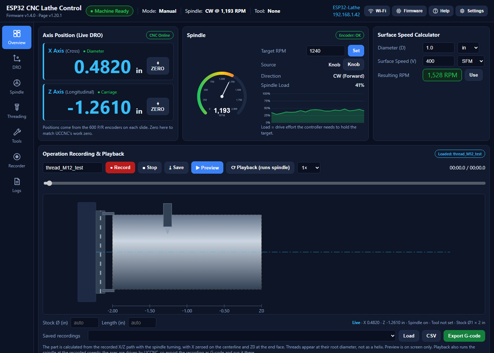
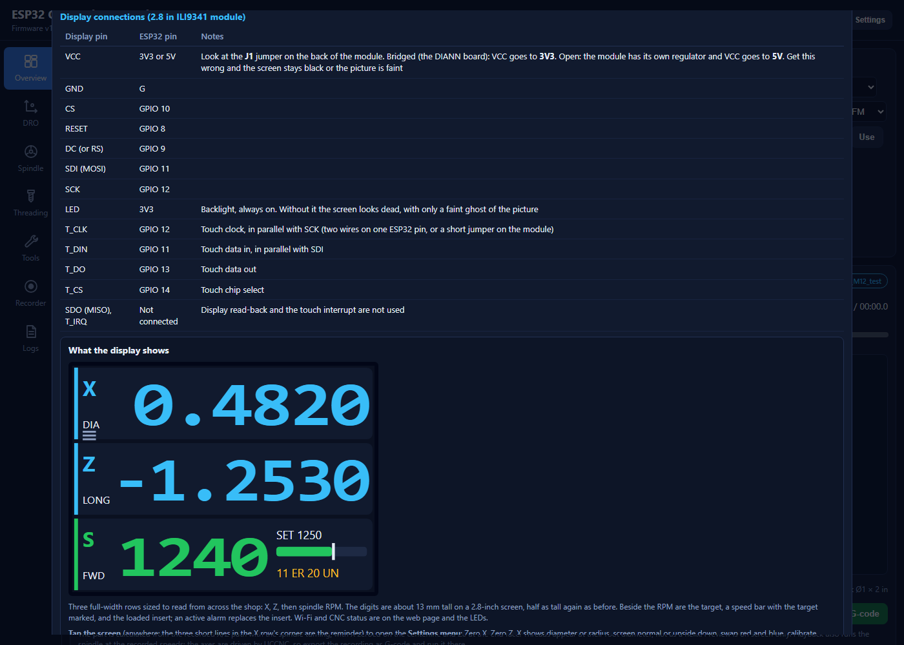
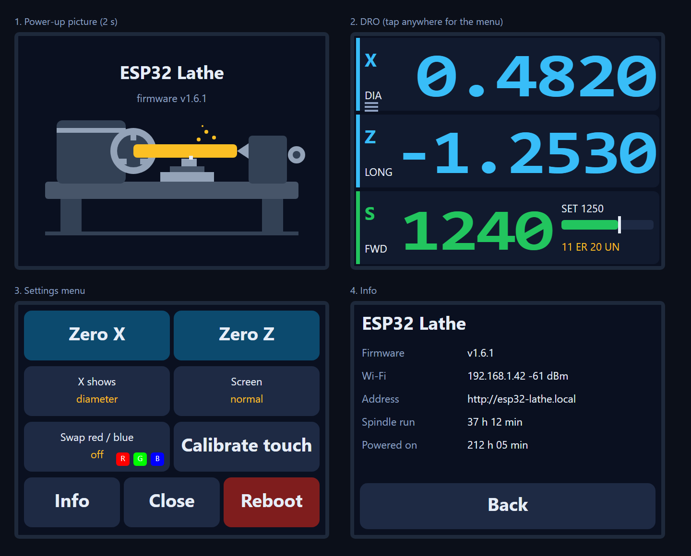
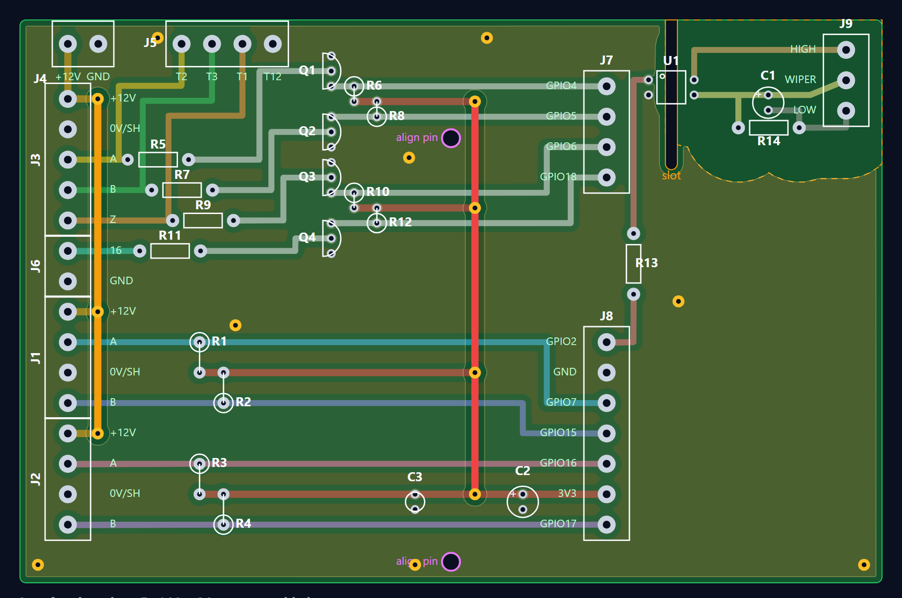
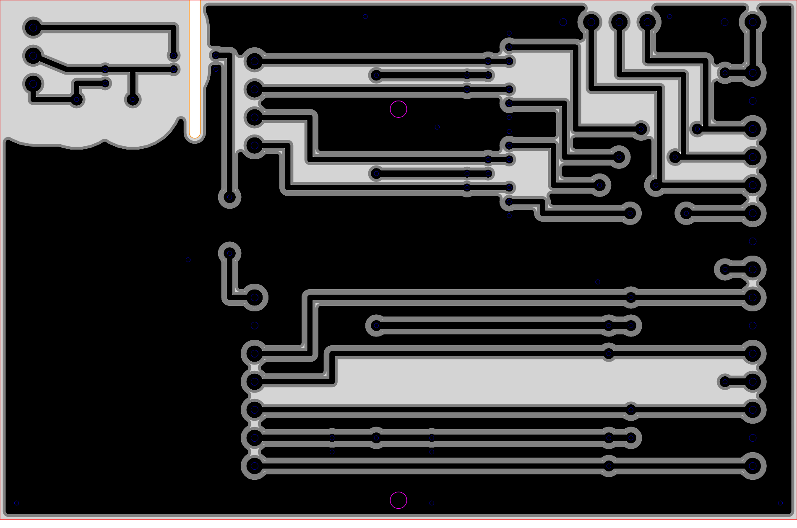
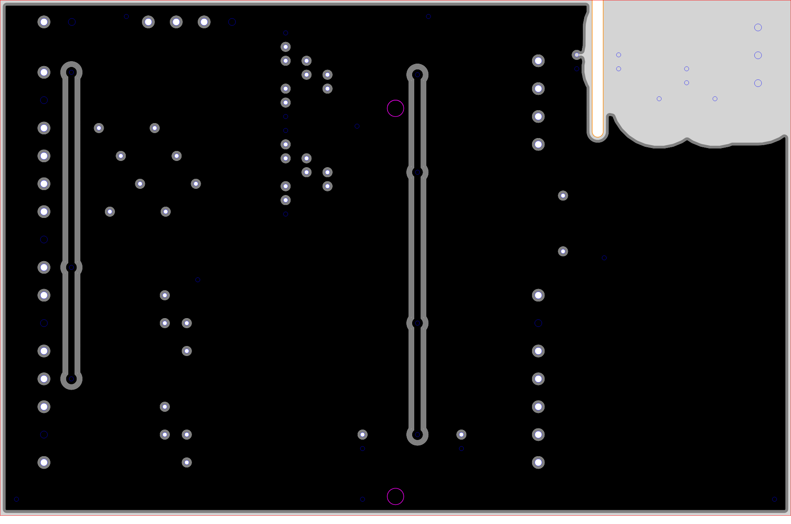
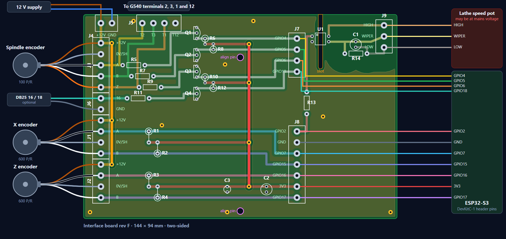
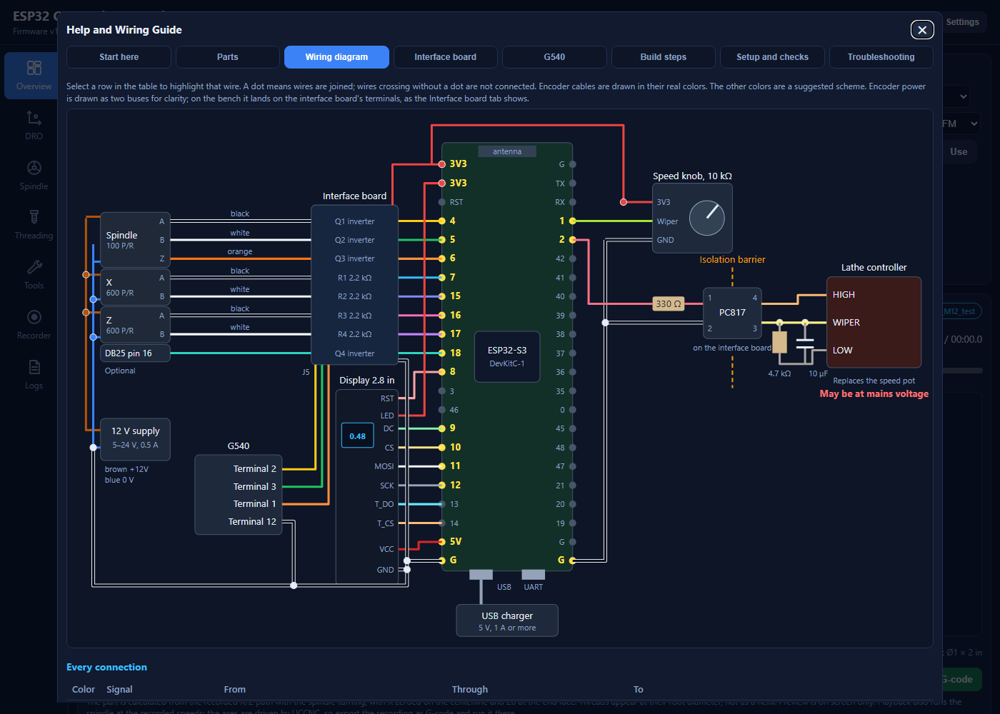
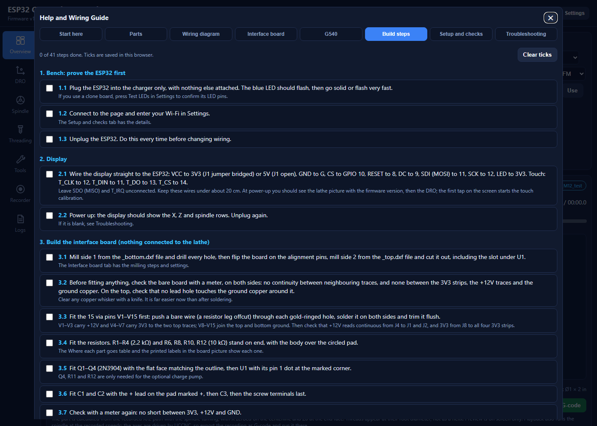

# ESP32-S3 Lathe Control: build guide

A step-by-step guide to building the controller: flashing the ESP32-S3, wiring the touch display, milling and populating the interface board, mounting the encoders, connecting the G540 and the lathe, and calibrating. The same guide, with the interactive wiring diagram and tick-off checklist, is on the dashboard under **Help**; this copy lives with the code so it can be read without the ESP32.

Versions this guide matches: firmware **1.6.0**, web page **1.20.x**, interface board **rev F**. The `CHANGELOG.md` lists what changed since.

## What the finished system does

| Function | How |
| --- | --- |
| Live DRO for X and Z | A 600 P/R encoder on each slide, counted in hardware (2400 counts per rev) |
| Spindle RPM and direction, closed-loop speed control | The 100 P/R spindle encoder, and a PC817 optocoupler driving the lathe's own speed-pot input |
| 2.8 in touch display at the machine | X, Z and RPM in 13 mm digits; a tap opens a Settings menu (zero, diameter, flip, colours, calibrate, Info, reboot) |
| Web dashboard over Wi-Fi | Settings, recording and playback with G-code export, threading presets, run hours, alarms, OTA updates |
| CNC Online indicator (optional) | A tap on the G540 charge-pump line |

It never drives the steppers and never replaces the lathe's E-stop.

## 1. Parts

### Required

| Qty | Part | Used for | Notes |
| --- | --- | --- | --- |
| 1 | ESP32-S3 dev board, 44-pin | The controller | At least 8 MB flash and octal PSRAM (N8R8 or N16R8) |
| 1 | USB charger, 5 V 1 A or more, and cable | Powers the ESP32 and the display | A noisy charger causes false counts |
| 1 | 2.8 in ILI9341 SPI TFT, 320 × 240, **touch version** (XPT2046) | DRO, RPM and status at the machine | The common red-board module |
| 2 | Omron E6B2-CWZ6C encoder, **600 P/R** | X and Z position | Must be the CWZ6C (open collector), 6 mm shaft |
| 1 | Omron E6B2-CWZ6C encoder, **100 P/R** | Spindle speed and direction | Skip if already fitted; turns 1:1 with the spindle |
| 1 | 12 V DC supply, 0.5 A or more | Powers the three encoders | Any 5–24 V supply works |
| 2 | Flexible shaft coupling, 6 mm to your shaft | Drives each axis encoder | Jaw or bellows type |
| 2 | Encoder mounting bracket | Holds each axis encoder | Made to suit your lathe |
| 4 | 2.2 kΩ resistor, 1/4 W | R1–R4, axis encoder pull-ups | |
| 3 (4) | 2N3904 NPN transistor | Q1–Q3 spindle encoder inverters (Q4 for the optional charge pump) | |
| 6 (8) | 10 kΩ resistor, 1/4 W | R5–R10 (R11, R12 for the charge pump) | |
| 1 | PC817 optocoupler, DIP-4 | U1, isolates spindle control | |
| 1 | 330 Ω resistor, 1/4 W | R13, PC817 LED current | About 6 mA from 3.3 V |
| 1 | 4.7 kΩ resistor, 1/4 W | R14, speed signal filter | |
| 1 | 10 µF electrolytic capacitor, 25 V | C1, speed signal filter | At least double your pot voltage |
| 1 each | 100 µF and 0.1 µF capacitors | C2, C3, steady the 3.3 V rail | |
| 1 | 10 kΩ linear potentiometer and knob | Speed knob | Linear (B taper) |
| 1 | Copper-clad FR-4, 150 × 100 mm, **double-sided** | The interface board, milled from the DXFs | Both sides are used |
| 2 | 3 mm dowel pins, or two 1/8 in drill bits used shank down | Locate the board when flipping it | |
| 35 ways | Screw terminal blocks, 5.08 mm pitch | J1–J9 | 2- and 3-way blocks slot together |
| About 10 cm | Bare tinned copper wire, 0.5–0.6 mm | Via pins V1–V15 | Resistor leg offcuts work |
| 1 set | Stranded hookup wire, 22–24 AWG | Board, ESP32 and display wiring | The G540 needs stranded 14–24 AWG |
| 1 | 4-core cable, shielded if possible | Interface board to G540 terminals 1, 2, 3, 12 | |

### Optional and recommended

DB25 male-female breakout (plus one 2N3904 and two 10 kΩ) for the CNC Online signal; shielded 5-core cable if the encoder leads need extending; a plastic enclosure with a window for the display; 22-way header sockets so the ESP32 can be swapped; encoder guards; heat-shrink, ferrules, cable ties and labels.

Tools: soldering iron, multimeter, wire strippers, small flat screwdriver, and a dial indicator for calibrating the axes. A CNC router with a 30° V-bit or a 0.3–0.5 mm end mill, a 0.8 mm and a 1.3 mm drill, and a 1.5 mm or smaller end mill for the board.

## 2. Flash the ESP32 and prove it on the bench

1. Install PlatformIO (the VS Code extension, or `pip install platformio`).
2. In the project folder: `pio run -t upload` (firmware), then `pio run -t uploadfs` (the web page in `data/`).
3. Plug the ESP32 into the charger with nothing else attached. The blue LED flashes, then goes solid or flashes very fast.
4. First boot: no Wi-Fi is configured, so it opens the access point **ESP32-Lathe** (password `lathe1234`). Join it, open http://192.168.4.1, enter your Wi-Fi name and password in **Settings**, and **Save & reboot**.
5. Afterwards the dashboard is at http://esp32-lathe.local (or the IP shown on the page and on the display's Info screen). Later firmware goes in through the **Firmware** window on the page.
6. Unplug the ESP32. Do this every time before you change wiring.

## 3. The display

Wire the module straight to the ESP32-S3 DevKitC-1. Keep the wires under about 20 cm.

| Module pin | ESP32 pin | Notes |
| --- | --- | --- |
| VCC | **3V3** or **5V** | Look at the **J1** jumper on the back. Bridged (the DIANN board): 3V3. Open: 5V (the module then regulates it down). Wrong choice: black screen or a faint picture |
| GND | G | |
| CS | GPIO 10 | |
| RESET | GPIO 8 | |
| DC (RS) | GPIO 9 | |
| SDI (MOSI) | GPIO 11 | |
| SCK | GPIO 12 | |
| LED | 3V3 | Backlight. Without it the screen looks dead with only a ghost of the picture |
| T_CLK | GPIO 12 | In parallel with SCK (second wire on the pin, or a short jumper on the module) |
| T_DIN | GPIO 11 | In parallel with SDI |
| T_DO | GPIO 13 | |
| T_CS | GPIO 14 | |
| SDO (MISO), T_IRQ | not connected | |

Power up. You should see the lathe picture with the firmware version for two seconds, then the DRO. The **first tap** on the screen starts the touch calibration: press the three crosses as they appear, firmly, with a fingernail or the stylus. After that, a tap anywhere opens the Settings menu.

If the colours look wrong (the workpiece in the power-up picture should be brass yellow; in the menu the squares marked R, G and B should be red, green and blue), turn on **Swap red / blue** in the menu. Everything set in the menu is saved. Unplug again.

## 4. Mill the interface board

The board is two-sided, 144 × 94 mm, milled from a 150 × 100 blank with no plated holes: via pins (bare wire soldered both sides) join the two layers. The files are written by `hardware/make_pcb.py` and also served by the ESP32 under Help → Interface board. Use both sides from the **same revision**.

The mill files (`board_revF_bottom.dxf`, `board_revF_top.dxf`, and the same as `.svg`) have one layer per machining operation:

| Layer | Operation |
| --- | --- |
| `ISO_CENTER` | Cutter centre lines for a 0.5 mm cutter: engrave along them with **no offset**, about 0.1 mm deep. A 30° V-bit or a 0.3–0.5 mm end mill |
| `CLEAR_POCKET` | Pocket out completely, 0.1–0.15 mm deep, with a 0.8–1.6 mm end mill. They run 1 mm past the board edge |
| `COPPER_REF` | The copper that stays. Reference only: never cut it |
| `DRILL_0P8`, `DRILL_1P3` | Holes at true size (0.8 mm: resistors, transistors, U1, capacitors, vias; 1.3 mm: screw terminals) |
| `ALIGN_3P0` | The two 3 mm alignment holes |
| `SLOT` | The 2 mm isolation slot under U1: a through pocket with a 1.5 mm or smaller end mill |
| `OUTLINE` | The board edge, a plain rectangle: cut last |

Steps:

1. **Set up.** Fresh, flat double-sided blank taped to the spoilboard. Work zero 3 mm in from the blank's corner; keep the same X and Y zero for both sides.
2. **Side 1, alignment holes.** Load `…_bottom.dxf`. Drill the two `ALIGN_3P0` holes through the blank and 5 mm into the spoilboard. They sit on the board's vertical centre line, one near the bottom edge and one above the middle, so the board only fits the pins one way round.
3. **Side 1, copper.** Engrave `ISO_CENTER`, pocket `CLEAR_POCKET`.
4. **Side 1, drill.** `DRILL_0P8` and `DRILL_1P3`.
5. **Flip.** Push 3 mm pins into the spoilboard holes, standing about 1 mm proud. Turn the board over **left to right** (top edge stays at the top) onto the pins, tape it, re-probe Z.
6. **Side 2, copper.** Load `…_top.dxf`. Engrave `ISO_CENTER`, pocket `CLEAR_POCKET`. Don't drill again. Check the rings are centred on the holes.
7. **Side 2, slot then outline.** Pocket `SLOT` right through, then cut `OUTLINE` on the outside of the line, with tabs.
8. Deburr, scrub both sides, and check with a meter that no two neighbouring traces touch, and that no lead hole touches the top ground copper.

Why the pockets matter: an isolation groove only separates shapes. Copper that belongs to no shape (the 8 mm zone round the lathe side, the edge margin) would stay as loose islands that can bridge the isolated lathe side to the ESP32 side. Always pocket, especially the top right corner.

## 5. Populate the board

1. Check the bare board with a meter on both sides: no continuity between neighbouring traces, none between the 3V3 strips, the +12V traces and the ground copper; on the top, no lead hole touching the ground copper around it. Clear any whisker with a knife now.
2. Fit the **15 via pins V1–V15** first: bare wire through each gold-ringed hole, soldered on both sides, trimmed flush. V1–V3 carry +12V and V4–V7 carry 3V3 to the two top traces; V8–V15 join top and bottom ground. Then check +12V is continuous from J4 to J1 and J2, and 3V3 from J8 to all four 3V3 strips.
3. Resistors. R1–R4 (2.2 kΩ) and R6, R8, R10, R12 (10 kΩ) stand on end with the body over the circled pad.
4. Q1–Q4 (2N3904) with the flat face matching the outline; U1 with its pin 1 dot at the marked corner. Q4, R11 and R12 are only for the optional charge pump.
5. C1 and C2 with the + lead on the pad marked +; then C3; screw terminals last.
6. Meter again: no short between 3V3, +12V and GND.
7. Wire J7 to the ESP32 (GPIO 4, 5, 6, 18) and J8 (GPIO 2, G, GPIO 7, 15, 16, 3V3, 17). Pin names are printed beside each screw.
8. Power up and measure each axis input at the ESP32: about 3.3 V with nothing connected. Unplug again.

Where each part goes:

| Ref | Value | From | To |
| --- | --- | --- | --- |
| R1–R4 | 2.2 kΩ | J1 A / J1 B / J2 A / J2 B (encoder black and white, on to GPIO 7, 15, 16, 17) | 3V3 rail |
| R5, R7, R9 | 10 kΩ | J3 A / B / Z (also J5 T2 / T3 / T1) | Q1 / Q2 / Q3 base |
| R6, R8, R10 | 10 kΩ | Q1 / Q2 / Q3 collector (on to GPIO 4 / 5 / 6) | 3V3 rail |
| R11, R12 (optional) | 10 kΩ | J6 pin 16 → Q4 base; Q4 collector → GPIO 18 | |
| Q1–Q4 | 2N3904 | Emitter to the GND rail | |
| R13 | 330 Ω | J8 GPIO 2 | U1 pin 1 |
| U1 | PC817 | Pin 2 to ground | Pin 4 to J9 HIGH, pin 3 to J9 WIPER |
| R14, C1 | 4.7 kΩ, 10 µF | J9 WIPER | J9 LOW |
| C2, C3 | 100 µF, 0.1 µF | 3V3 rail | GND rail |
| J1, J2 | 4-way | X / Z encoder: +12V, A, 0V/SH, B | |
| J3 | 5-way | Spindle encoder: +12V, 0V/SH, A, B, Z | |
| J4 | 2-way | 12 V supply | |
| J5 | 4-way | To the G540: T2, T3, T1, T12 | |
| J6 (optional) | 2-way | DB25 pin 16, GND | |
| J7 | 4-way | To the ESP32: GPIO 4, 5, 6, 18 | |
| J8 | 7-way | To the ESP32: GPIO 2, GND, GPIO 7, 15, 16, 3V3, 17 | |
| J9 | 3-way | To the lathe: HIGH, WIPER, LOW | **Isolated.** Never joined to any other ground |

## 6. The speed knob

Outer lugs to 3V3 and GND, centre lug to GPIO 1. If the speed rises the wrong way, swap the outer lugs.

## 7. Mount the X and Z encoders (machine off)

1. Drive each encoder from the free end of the leadscrew (best) or the stepper's back shaft. On the leadscrew the DRO includes any backlash between motor and screw; neither position sees backlash in the nut.
2. Make a rigid bracket holding the encoder in line with the shaft. Any flex becomes a DRO error.
3. Join encoder and shaft with a flexible coupling, aligned by eye. Never couple rigidly.
4. Write down the travel per encoder revolution: screw lead × any gearing. It goes into Settings; calibration fine-tunes it.
5. Turn each handwheel through its full travel: nothing may bind or rub.

## 8. Connect the cables (all power off)

1. X encoder to J1: brown +12V, blue 0V, black A, white B. Shield into the 0V/SH screw with the blue wire; insulate the orange wire; leave the shield unconnected at the encoder end.
2. Z encoder to J2, the same way.
3. Spindle encoder to J3: brown, blue, black A, white B, orange Z, shield with the blue wire. If it was wired to the G540, move those wires to J3: J5 now feeds the G540.
4. 4-core cable from J5 to the G540: T2 → terminal 2, T3 → 3, T1 → 1, T12 → 12. Stranded wire, no wire plugs.
5. 12 V supply to J4. **Never use G540 terminal 11**: it can be up to 50 V.
6. Route encoder cables away from motor and mains wiring.
7. Optional CNC Online: a DB25 breakout between the UC100 and the G540; pin 16 → J6 pin 16, pin 18 → J6 GND.

## 9. Spindle control, last (lathe unplugged)

The lathe's speed-pot circuit may sit at mains potential. The PC817, the 8 mm bare zone and the slot under U1 are the only things between it and the low-voltage side.

1. **Unplug the lathe from the wall** and wait for the controller to discharge.
2. Identify HIGH, WIPER and LOW at the speed pot and label them. With the lathe powered, measure between HIGH and LOW (DC and AC) and between each of them and mains earth, then unplug again. HIGH to LOW must be **under 25 V**, C1's rating (it is usually 5–12 V). If either pin reads anything against earth, the whole circuit floats at mains potential: treat J9, R14, C1 and the lathe side of U1 as live, keep them inside the controller enclosure, and never let a wire or tool bridge the gap. If HIGH–LOW is over 25 V, or you cannot measure it, do not connect the board.
3. Disconnect the pot and wire HIGH, WIPER and LOW to J9.
4. Check J8 GPIO 2 is wired to the ESP32.
5. With everything unplugged: **no continuity** between ESP32 GND and any J9 terminal. If there is, find it before going on.
6. Insulate and secure the controller wires so they cannot touch the low-voltage side.

## 10. Power up and calibrate

1. Mount the board, ESP32 and display in the enclosure; strain-relieve every cable. Keep the enclosure in Wi-Fi reach and away from chips and coolant.
2. Turn on the encoder supply, the G540 and the PC, then the ESP32. Leave the lathe unplugged. Check UCCNC still sees the spindle inputs.
3. In **Settings** enter: spindle PPR 100; X and Z P/R 600; travel per encoder revolution for each axis (inches; X is radial); X shows diameter; Max RPM; KP 0.0004, KI 0.0012; soft limits. If an axis counts backwards, tick **Invert count** for it.
4. Turn each handwheel and check the DRO follows. Calibrate X and Z with a dial indicator (method on Help → Setup and checks).
5. Set **Max RPM to 500** and the target to 0 for first tests.
6. Chuck empty, area clear: plug in the lathe and raise the target slowly to 200 RPM, hand on the E-stop. If the spindle jumps to full speed, stop and read Troubleshooting in Help.
7. Finish the checks on Help → Setup and checks, then raise Max RPM to your lathe's limit.

## 11. Day to day

- The display's **Settings menu** (tap anywhere): Zero X, Zero Z, X shows diameter/radius, screen normal/upside down, swap red/blue, calibrate touch, Info (firmware, Wi-Fi, address, spindle run hours, powered-on hours), Close, Reboot. It closes itself after 30 s.
- Spindle hours count every second the spindle turns and are saved every minute; the web page's Run hours card shows the same figure.
- Firmware updates: upload `firmware.bin` in the Firmware window. Page updates: **Upload Filesystem Image** from PlatformIO (this erases saved recordings).

